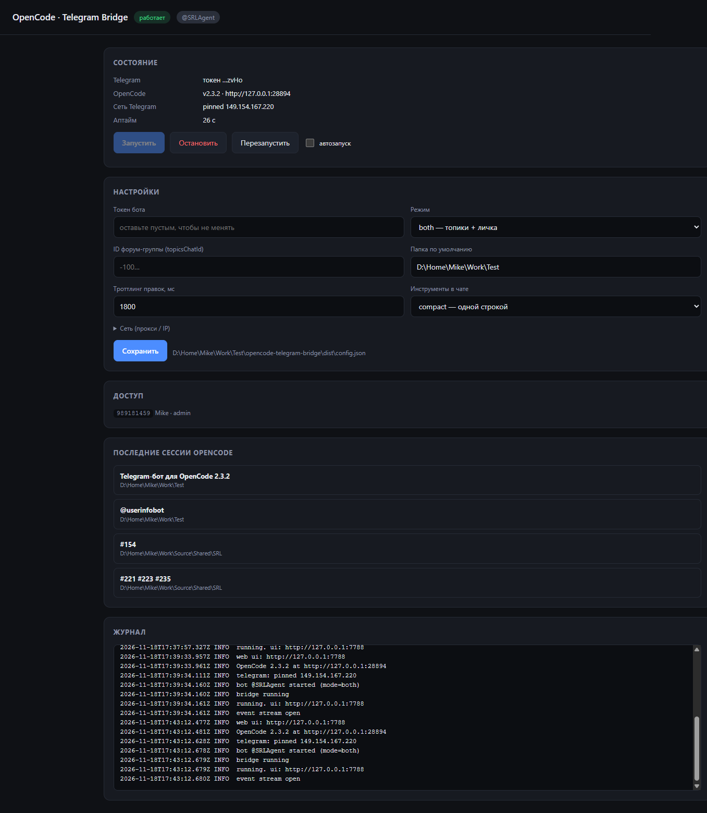

# OpenCode Telegram Bridge

Управление сессиями **OpenCode 2.x** из Telegram: задача текстом или голосом, ответ
с форматированием и статистикой, разрешения — кнопками. Мост подключается к тому же
фоновому сервису OpenCode, что Desktop и TUI, поэтому видит **те же сессии**;
плагин OpenCode не нужен.



## Возможности

- Форум-группа: **тема = сессия**, плюс личные чаты; режимы `both`, `private`, `topics`.
- Стриминг ответа в одном сообщении, rich-разметка (таблицы, код, заголовки).
- Футер хода: `⏱` длительность, `⚡` tok/s, `🧠` контекст — как в интерфейсе OpenCode.
- Кнопки разрешений: «Разрешить», «Всегда», «Отклонить».
- Голосовые: OGG/Opus → ffmpeg → HEX, локально, без облака.
- Фото и документы до 20 МБ уходят в сессию.
- Десктоп-оболочка: трей, автозапуск, темы OpenCode/Matrix, язык RU/EN.
- CLI `ocbridge-cli` для статуса, логов, конфига и диагностики.
- Обход блокировки Telegram: пиннинг рабочего IP или свой прокси.

## Быстрый старт

### Установщик (Windows 10/11)

1. Запустите `ocbridge-setup-0.3.0.exe`.
2. Вставьте токен бота от [@BotFather](https://t.me/BotFather) — можно пропустить
   и указать позже в панели `http://127.0.0.1:7788`.
3. Напишите боту `/start` — первый пользователь становится администратором.
4. Отправьте задачу.

Автозапуск включается в установщике, в трее или в панели. Для форум-группы:
включите темы, добавьте бота админом с правом «Управление темами» и отправьте
`/chatid` — подробности в [docs/telegram.md](docs/telegram.md).

### Из исходников

```bash
bun install
bun run src/index.ts --ui     # dev-режим, открывает панель
bun run typecheck
bun run build                 # dist/ocbridge.exe
bun run src/doctor.ts         # проверка связки с OpenCode
```

Установщик и остальные компоненты: [docs/build-and-release.md](docs/build-and-release.md).

## Как это работает

```
Telegram ⇄ grammY (long polling) ⇄ Bridge ⇄ OpenCode HTTP API
                                     ├─ /api/session/{id}/prompt, /interrupt, /permission/*
                                     ├─ SSE /api/event (text.delta, execution.*, permission.asked)
                                     └─ state.json (тема/чат ⇄ сессия)
```

Проверено на OpenCode 2.3.2: конец хода — `session.execution.*` (`session.idle` не
приходит), SSE-фильтр принимает повторяющиеся `types`, поток волатильный.
Подробнее: [docs/opencode-integration.md](docs/opencode-integration.md).

## Данные и безопасность

- Токен и настройки — только в `%APPDATA%\opencode-telegram-bridge\config.json`;
  в репозиторий и сборки он не попадает.
- Веб-панель слушает `127.0.0.1`, наружу не открывается.
- Исходящие соединения: long polling к Telegram и localhost-запросы к OpenCode.
- Доступ по allowlist; первый `/start` в пустом конфиге делает пользователя админом.
- `config.json` содержит токен — не публикуйте его и не коммитьте.

## Документация

| Раздел | Содержание |
|---|---|
| [docs/README.md](docs/README.md) | Индекс всех глав |
| [docs/architecture.md](docs/architecture.md) | Компоненты, порты, файлы |
| [docs/opencode-integration.md](docs/opencode-integration.md) | Эндпоинты и SSE |
| [docs/telegram.md](docs/telegram.md) | Команды, режимы, права, медиа |
| [docs/voice.md](docs/voice.md) | Голос и HEX |
| [docs/ui.md](docs/ui.md) | Темы, язык, Electron |
| [docs/cli.md](docs/cli.md) | `ocbridge-cli` |
| [docs/build-and-release.md](docs/build-and-release.md) | Сборка и релиз |
| [docs/troubleshooting.md](docs/troubleshooting.md) | Частые проблемы |

## Лицензия

MIT — см. [LICENSE](LICENSE).
