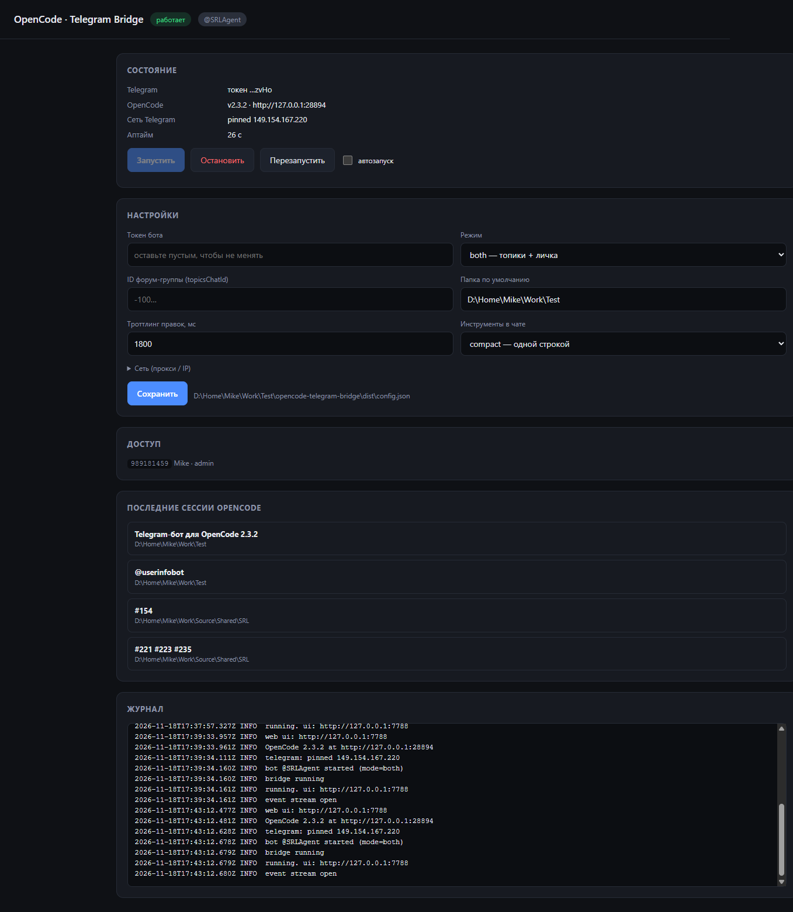

[English](../README.md) · [Русский](README.md)

# OpenCode Telegram Bridge

Управление сессиями **OpenCode 2.x** из Telegram: задача текстом или голосом, ответ
с форматированием и статистикой, разрешения — кнопками. Мост подключается к тому же
фоновому сервису OpenCode, что Desktop и TUI, поэтому видит **те же сессии**;
плагин OpenCode не нужен.



## Возможности

- Форум-группа: **тема = сессия**, плюс личные чаты; режимы `both`, `private`, `topics`.
- Стриминг ответа в одном сообщении, rich-разметка (таблицы, код, заголовки).
- Футер хода: `⏱` длительность, `⚡` tok/s, `🧠` контекст — как в интерфейсе OpenCode.
- Кнопки разрешений: «Разрешить», «Всегда», «Отклонить».
- Формы и выбор вариантов: вопросы OpenCode (`form.created`) приходят кнопками,
  мультивыбором и селект-меню/модалками; ответы уходят в API формы, сообщение
  правится на выбранные подписи.
- Бюджеты: лимиты стоимости хода и дня (USD), предупреждения на 80% и
  необязательное прерывание на 100% (`budget` в конфиге, `/budget`,
  `ocbridge-cli budget`).
- Режимы разрешений: `ask` / `auto` / `plan`, `/mode` меняет ruleset сессии;
  новые сессии берут `permissions.mode`.
- `/recent`: недавние сессии всех проектов с маркером `🔔` и подключением в один
  клик (тема/тред).
- Атомарная запись и тесты: config/state пишутся через temp+rename с одним
  `.bak`; `bun test` покрывает чистые модули в CI.
- Тихий статус: иконка темы `⏳` пока идёт ход и `✅` по завершении, затем через
  ~10 с возвращается обычная — без служебных сообщений. Переименование
  темы/треда — по желанию (`ui.titleStatus: "rename"`; в Discord маркеры по
  умолчанию выключены).
- Панель с разделами: Статус, Настройки, Telegram, Discord, Обновления и Журнал
  в левой навигации, которая уже 900 px сворачивается в полосу иконок; у Telegram
  и Discord независимые переключатели `enabled`.
- Журнал и сессии: пауза, скачивание, число строк, фильтр уровня и поиск;
  «Текущие сессии» со скрытием строки (только в панели) и обновлением.
- Голосовые: OGG/Opus → ffmpeg → HEX, локально, без облака.
- Фото и документы до 20 МБ уходят в сессию.
- Discord-транспорт: публичные треды, те же сессии, оба транспорта одновременно.
- Пересылка файлов между всеми привязанными чатами (тема/чат Telegram и тред/канал
  Discord) со ссылкой вместо файла сверх лимита платформы.
- Десктоп-оболочка: трей, автозапуск, темы OpenCode/Matrix, язык RU/EN.
- CLI `ocbridge-cli` для статуса, логов, конфига и диагностики.
- Обход блокировки Telegram: пиннинг рабочего IP или свой прокси.

## Быстрый старт

### Установщик (Windows 10/11)

1. Запустите `ocbridge-setup-standalone-0.8.2.exe` (офлайн) или
   `ocbridge-setup-lite-0.8.2.exe` (скачивает portable-bundle, ~2 МБ). Готовый
   layout также лежит в `ocbridge-bundle-0.8.2.zip`.
2. Вставьте токен бота от [@BotFather](https://t.me/BotFather) — можно пропустить
   и указать позже в панели `http://127.0.0.1:7788`.
3. Напишите боту `/start` — первый пользователь становится администратором.
4. Отправьте задачу.

Автозапуск включается в установщике, в трее или в панели. Для форум-группы:
включите темы, добавьте бота админом с правом «Управление темами» и отправьте
`/chatid` — подробности в [telegram.md](telegram.md).

### Из исходников

```bash
bun install
bun run src/index.ts --ui     # dev-режим, открывает панель
bun run typecheck
bun run build                 # dist/ocbridge.exe
bun run src/doctor.ts         # проверка связки с OpenCode
```

Установщик и остальные компоненты: [build-and-release.md](build-and-release.md).

## Как это работает

```
Telegram ⇄ grammY (long polling) ⇄ Bridge ⇄ OpenCode HTTP API
                                     ├─ /api/session/{id}/prompt, /interrupt, /permission/*
                                     ├─ SSE /api/event (text.delta, execution.*, permission.asked)
                                     └─ state.json (тема/чат ⇄ сессия)
```

Проверено на OpenCode 2.3.2: конец хода — `session.execution.*` (`session.idle` не
приходит), SSE-фильтр принимает повторяющиеся `types`, поток волатильный.
Подробнее: [opencode-integration.md](opencode-integration.md).

## Данные и безопасность

- Токен и настройки — только в `%APPDATA%\opencode-telegram-bridge\config.json`;
  в репозиторий и сборки он не попадает.
- Веб-панель слушает `127.0.0.1`, наружу не открывается.
- Исходящие соединения: long polling к Telegram и localhost-запросы к OpenCode.
- Доступ по allowlist; первый `/start` в пустом конфиге делает пользователя админом.
- `config.json` содержит токен — не публикуйте его и не коммитьте.

## Документация

| Раздел | Содержание |
|---|---|
| [README.md](README.md) | Этот файл и индекс глав |
| [architecture.md](architecture.md) | Компоненты, порты, файлы |
| [opencode-integration.md](opencode-integration.md) | Эндпоинты и SSE |
| [telegram.md](telegram.md) | Команды, режимы, права, медиа |
| [media.md](media.md) | Пересылка файлов: лимиты и fallback |
| [discord.md](discord.md) | Discord-транспорт и лимиты |
| [voice.md](voice.md) | Голос и HEX |
| [ui.md](ui.md) | Темы, язык, Electron |
| [cli.md](cli.md) | `ocbridge-cli` |
| [build-and-release.md](build-and-release.md) | Сборка и релиз |
| [update.md](update.md) | Автообновление GitHub: проверка, загрузка, SHA256, установка |
| [troubleshooting.md](troubleshooting.md) | Частые проблемы |
| [process/speckit.md](process/speckit.md) | Spec-driven: spec → plan → tasks → тесты → ручная проверка |

English documentation: [../README.md](../README.md).

## Лицензия

MIT — см. [LICENSE](../../LICENSE).
